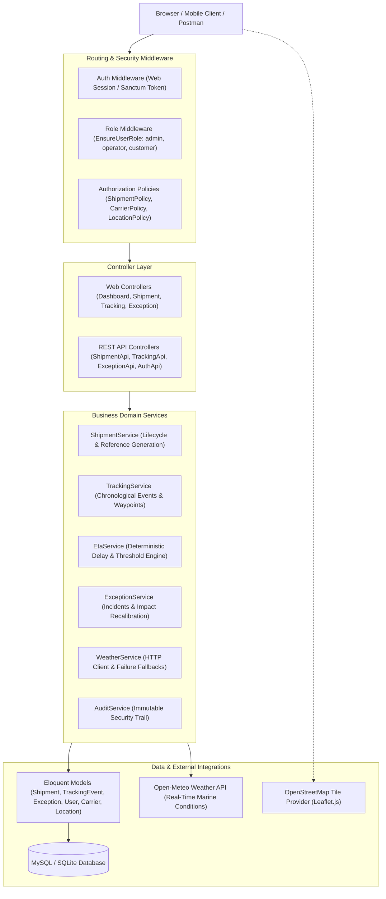
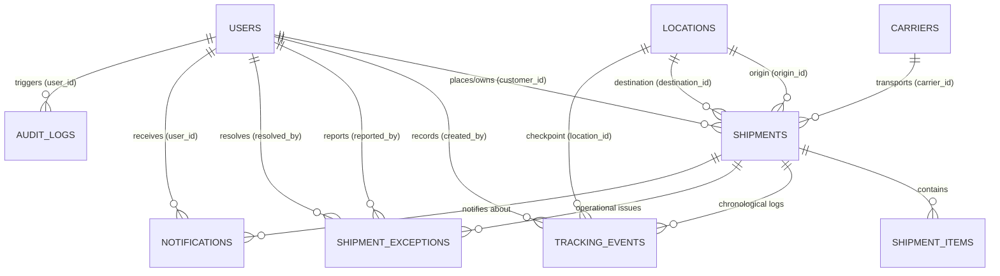

# CargoTrace — Global Shipment Visibility & Tracking Platform

[](https://laravel.com)
[](https://www.php.net)
[](https://tailwindcss.com)
[](https://leafletjs.com)
[](https://www.openstreetmap.org)
[-brightgreen?style=for-the-badge)](https://phpunit.de)

> **Web Programming 2 — Final Project (UAS)**  
> Built as an enterprise-grade software engineering portfolio project demonstrating real-time shipment visibility, deterministic business rules, strict role-based access control, interactive geospatial mapping, external weather API telemetry, and a complete RESTful API contract.

---

## 1. Problem & Solution Overview

### The Problem in Global Freight
- **Fragmented Shipment Visibility**: Freight forwarding and intermodal logistics data is frequently dispersed across legacy spreadsheets and disconnected proprietary tracking portals.
- **Blind Transits & Uncertainty**: Consignees and customers are unable to pinpoint actual vessel locations, current voyage status, and live route progression.
- **Undetected Delays & Surprises**: Weather anomalies, port congestions, and customs holds occur silently without centralized automated delay threshold detection.
- **Operational Chaos**: Logistics dispatchers lack an integrated dashboard to prioritize high-severity exceptions and communicate resolution timelines.

### The CargoTrace Solution
- **End-to-End Lifecycle State Machine**: Strictly validates progression (`CREATED` &rarr; `BOOKED` &rarr; `PICKED_UP` &rarr; `IN_TRANSIT` &rarr; `DELIVERED`). Terminal states cannot be illegally reverted.
- **Chronological Tracking Timeline & Leaflet Map**: Renders full voyage polylines and historical waypoint markers with weather telemetries on OpenStreetMap.
- **Configurable ETA & Delay Engine**: Compares estimated arrival with expected arrival against configurable group thresholds (`12h`, `18h`, `24h`), automatically classifying delay severities (`LOW`, `MEDIUM`, `HIGH`).
- **Operational Exception Handling**: Manages customs holds, severe weather delays, port congestions, and cargo damage with full audit trails and customer alerts.
- **Dual Interface**: Full-featured server-rendered Blade + Tailwind CSS web application paired with a token-authenticated JSON REST API (Sanctum).

---

## 2. System Architecture

CargoTrace strictly implements the **Service-Layer Architecture Pattern** to decouple HTTP controllers from business domain logic and database transactions:



---

## 3. Entity Relationship Diagram (ERD) & Data Dictionary

### ERD Diagram



### Data Dictionary

| Table | Column | Type | Constraints | Description |
|---|---|---|---|---|
| `users` | `id` | BIGINT (PK) | Auto increment | Unique user identifier |
| | `name` | VARCHAR(255) | NOT NULL | User / Company representative full name |
| | `email` | VARCHAR(255) | UNIQUE, NOT NULL | Account login email |
| | `password` | VARCHAR(255) | NOT NULL | Bcrypt hashed password |
| | `role` | VARCHAR(20) | NOT NULL, DEFAULT 'customer' | `admin`, `operator`, `customer` |
| | `company` | VARCHAR(255) | NULLABLE | Business or trading company name |
| | `phone` | VARCHAR(30) | NULLABLE | Contact telephone |
| `carriers` | `id` | BIGINT (PK) | Auto increment | Unique carrier identifier |
| | `name` | VARCHAR(255) | NOT NULL | Carrier name (e.g. Maersk, Evergreen, ONE) |
| | `code` | VARCHAR(20) | UNIQUE, NOT NULL | Standard carrier alpha code (e.g. MAEU, EMC) |
| | `website` | VARCHAR(255) | NULLABLE | Official tracking portal URL |
| | `is_active` | BOOLEAN | DEFAULT TRUE | Carrier operating status |
| `locations` | `id` | BIGINT (PK) | Auto increment | Unique location identifier |
| | `name` | VARCHAR(255) | NOT NULL | Port / Terminal name (e.g. Port of Rotterdam) |
| | `code` | VARCHAR(20) | UNIQUE, NOT NULL | UN/LOCODE identifier (e.g. NLRTM, IDJKT) |
| | `type` | VARCHAR(30) | NOT NULL | `PORT`, `AIRPORT`, `WAREHOUSE`, `CHECKPOINT` |
| | `city`, `country`| VARCHAR(100) | NOT NULL | Geographic municipal & sovereign jurisdiction |
| | `latitude`, `longitude` | DECIMAL(10,7)| NOT NULL, INDEXED | Geographic coordinates for Leaflet map & weather |
| `shipments` | `id` | BIGINT (PK) | Auto increment | Primary key |
| | `shipment_number`| VARCHAR(50) | UNIQUE, NOT NULL | Auto-generated tracking number (`CT-YYYY-XXXX`) |
| | `customer_id` | BIGINT (FK) | NOT NULL | Belongs to `users.id` |
| | `carrier_id` | BIGINT (FK) | NOT NULL | Belongs to `carriers.id` |
| | `origin_id`, `destination_id`| BIGINT (FK)| NOT NULL | Belongs to `locations.id` |
| | `cargo_type` | VARCHAR(50) | NOT NULL | `GENERAL`, `REFRIGERATED`, `ELECTRONICS`, etc. |
| | `weight`, `volume` | DECIMAL(10,2)| Weight in kg, volume in CBM | Cargo dimensions |
| | `current_status` | VARCHAR(30) | NOT NULL, INDEXED | `CREATED`, `BOOKED`, `PICKED_UP`, `IN_TRANSIT`, `DELIVERED`, `CANCELLED` |
| | `expected_departure` | DATETIME | NOT NULL | Scheduled vessel departure (ETD) |
| | `expected_arrival` | DATETIME | NOT NULL | Scheduled destination arrival (ETA) |
| | `estimated_arrival` | DATETIME | NULLABLE | Recalibrated arrival ETA |
| | `actual_arrival` | DATETIME | NULLABLE | Discharge timestamp upon delivery |
| | `is_delayed` | BOOLEAN | DEFAULT FALSE, INDEXED | Boolean flag computed by `EtaService` |
| | `delay_duration_minutes` | INT | DEFAULT 0 | Absolute difference in minutes beyond expected arrival |
| | `delay_severity` | VARCHAR(20) | DEFAULT 'NONE' | `NONE`, `LOW`, `MEDIUM`, `HIGH` |
| `tracking_events` | `id` | BIGINT (PK) | Auto increment | Historical voyage checkpoint |
| | `shipment_id` | BIGINT (FK) | Cascade on delete | Target shipment |
| | `location_name`| VARCHAR(255) | NOT NULL | Waypoint or terminal description |
| | `status` | VARCHAR(40) | NOT NULL | Associated progress milestone |
| | `event_time` | DATETIME | NOT NULL | Historical occurrence timestamp |
| | `latitude`, `longitude`| DECIMAL(10,7)| NULLABLE | Checkpoint coordinates |
| | `is_exception` | BOOLEAN | DEFAULT FALSE | Highlights anomaly on timeline |
| | `weather_snapshot` | JSON | NULLABLE | Captured temperature, wind speed, condition |
| `shipment_exceptions`| `id` | BIGINT (PK) | Auto increment | Incident log |
| | `exception_type`| VARCHAR(50) | NOT NULL | `CUSTOMS_HOLD`, `WEATHER_DELAY`, `PORT_CONGESTION`, etc. |
| | `severity` | VARCHAR(20) | NOT NULL | `LOW`, `MEDIUM`, `HIGH`, `CRITICAL` |
| | `status` | VARCHAR(20) | NOT NULL | `OPEN`, `INVESTIGATING`, `RESOLVED` |
| | `detected_at` | DATETIME | NOT NULL | Occurrence detection timestamp |
| | `resolved_at` | DATETIME | NULLABLE | Resolution timestamp |
| | `resolution_notes`| TEXT | NULLABLE | Operator investigation notes |
| `audit_logs` | `id` | BIGINT (PK) | Auto increment | Security & compliance audit log |
| | `action` | VARCHAR(50) | NOT NULL | `CREATE`, `UPDATE`, `DELETE`, `STATUS_CHANGE`, `LOGIN` |
| | `auditable_type`, `id`| VARCHAR, BIGINT| NOT NULL | Entity mutated |
| | `old_values`, `new_values`| JSON | NULLABLE | JSON state before and after mutation |
| | `ip_address`, `user_agent`| VARCHAR, TEXT| Audit telemetry | Client connection source |

---

## 4. Business Rules & Logic

### 1. Shipment Lifecycle Transitions
Status changes are validated at the backend through `Shipment::canTransitionTo()` and `ShipmentService::transitionStatus()`:
- Allowed transitions:
  - `CREATED` &rarr; `BOOKED` or `CANCELLED`
  - `BOOKED` &rarr; `PICKED_UP` or `CANCELLED`
  - `PICKED_UP` &rarr; `IN_TRANSIT` or `CANCELLED`
  - `IN_TRANSIT` &rarr; `DELIVERED` or `CANCELLED`
  - `DELIVERED` &rarr; *Terminal State* (cannot be reverted or deleted without administrative privilege)
  - `CANCELLED` &rarr; *Terminal State*
- Attempts to execute illegal jumps (e.g. `CREATED` straight to `DELIVERED`, or reverting from `DELIVERED` back to `IN_TRANSIT`) immediately throw a `DomainException` and are returned as HTTP 422 JSON errors without leaking stack traces.

### 2. ETA & Delay Evaluation Rule
Evaluated automatically by `EtaService`:
$$\text{Delay} = \text{Reference Arrival} - \text{Expected Arrival}$$
- If $\text{Reference Arrival} \le \text{Expected Arrival}$: `is_delayed = false`, `severity = NONE`.
- If $\text{Reference Arrival} > \text{Expected Arrival}$:
  - $0 < \text{Delay} \le 6\text{ hours}$: `LOW` Severity
  - $6 < \text{Delay} \le 24\text{ hours}$: `MEDIUM` Severity
  - $\text{Delay} > 24\text{ hours}$: `HIGH` Severity
- Configurable scenario threshold (`CARGOTRACE_DELAY_THRESHOLD_HOURS=12`) per project brief scenario.

### 3. Chronological Tracking Integrity
Historical tracking events are append-only. Adding a new tracking event:
- Validates chronological timestamp against past checkpoints.
- Does not overwrite or delete previous tracking records.
- Automatically captures a real-time weather telemetry snapshot via `WeatherService`.
- Triggers notifications to the assigned customer.

---

### 4. Real-Time Visibility Engine & Maritime Simulator
CargoTrace includes a native **Real-Time Polling & Activity Stream Engine** designed to provide dynamic live tracking without requiring heavy external WebSocket brokers:
- **AJAX Auto-Refresh**: The Operations Dashboard polls `/realtime/dashboard-stats` every 5 seconds, updating KPI metric cards, Chart.js graphs, and recent shipment tables with animated micro-transitions without full page reload.
- **Live Activity Stream**: Tracks real-time GPS waypoint check-ins, container scans, and transit events across global sea corridors.
- **Tracking Detail Auto-Sync**: The shipment tracking page polls `/realtime/shipment/{id}/tracking` every 8 seconds, automatically refreshing Leaflet.js waypoint markers and progress stages.
- **Interactive Controls**: Users can pause/resume auto-refresh at any time using the dashboard live control pill.
- **Real-Time Simulator**: Built-in Artisan CLI command simulates realistic live maritime activity:
  ```bash
  # Run a single simulation step
  php artisan cargotrace:simulate

  # Run continuous simulation loop every 10 seconds (ideal for live demo!)
  php artisan cargotrace:simulate --loop=10
  ```

---

## 5. Map & External Weather API Integration

### Geospatial Mapping (Leaflet.js + OpenStreetMap)
- Rendered on the shipment detail page (`/shipments/{id}`).
- Visualizes origin marker (Green), waypoint checkpoints (Blue / Orange for exceptions), and destination port (Purple).
- Dashed polyline automatically traces the multimodal voyage path and fits the viewport bounding box.
- Interactive popups display milestone name, timestamp, current weather, and handling notes.
- Attribution to `OpenStreetMap contributors` is included adhering to tile provider policies.

### External Weather API Telemetry
- Integrated via Laravel `Http::timeout(4)->get(...)` querying the free [Open-Meteo](https://open-meteo.com) Marine & Terrestrial Weather API.
- **Resilience & Fault Tolerance**: Handled inside `try/catch` with timeouts. If network access is blocked or the service is temporarily unreachable, `WeatherService` gracefully falls back without crashing the transaction or interrupting shipment logging.
- **Zero Secret In Git**: Requires no proprietary API keys, keeping the repository safe from credential leaks.

---

## 6. User Roles & Security

| Feature / Resource | Administrator | Logistics Operator | Customer |
|---|:---:|:---:|:---:|
| **Dashboard** | Full Fleet Metrics | Full Fleet Metrics | Own Shipments Only |
| **View Shipments** | All Shipments | All Shipments | Owned Consignments Only |
| **Create Shipment** | :white_check_mark: Yes | :white_check_mark: Yes | :x: No (403 Forbidden) |
| **Update / Edit Shipment** | :white_check_mark: Yes | :white_check_mark: Yes | :x: No (403 Forbidden) |
| **Delete Shipment** | :white_check_mark: Yes | :white_check_mark: Non-delivered only | :x: No (403 Forbidden) |
| **Record Tracking Checkpoint**| :white_check_mark: Yes | :white_check_mark: Yes | :x: No (403 Forbidden) |
| **Log / Resolve Exceptions** | :white_check_mark: Yes | :white_check_mark: Yes | :x: Read-only relevant alerts |
| **Manage Carriers & Hubs** | :white_check_mark: Full CRUD | :white_check_mark: View Only | :white_check_mark: View Only |
| **Security Audit Trail** | :white_check_mark: Full Inspection | :x: No (403 Forbidden) | :x: No (403 Forbidden) |

Backend authorization is enforced at multiple layers:
1. **Middleware Layer**: `EnsureUserRole` verifies role tokens and session permissions.
2. **Policy Layer**: `ShipmentPolicy`, `CarrierPolicy`, and `LocationPolicy` verify granular resource ownership.
3. **Form Request Layer**: `CreateShipmentRequest`, `UpdateShipmentRequest`, and `CreateTrackingEventRequest` reject unauthorized payloads before reaching controller logic.

---

## 7. REST API Documentation

Base URL: `http://localhost:8000/api`  
All authenticated endpoints require the header: `Authorization: Bearer <sanctum_token>`.

### Authentication Endpoints
- `POST /api/register` — Register a customer account
- `POST /api/login` — Authenticate and receive a Bearer token
- `POST /api/logout` — Revoke current token
- `GET /api/user` — Retrieve profile of authenticated user

### Shipment Endpoints
- `GET /api/shipments` — List shipments (Supports filters: `status`, `carrier_id`, `origin_id`, `destination_id`, `is_delayed`, `search`, `per_page`)
- `POST /api/shipments` — Create shipment (Operator / Admin)
- `GET /api/shipments/{id}` — Get full shipment detail, items, and events
- `PUT/PATCH /api/shipments/{id}` — Update shipment attributes
- `DELETE /api/shipments/{id}` — Delete shipment

### Tracking & Exception Endpoints
- `GET /api/shipments/{id}/tracking` — Chronological tracking timeline
- `POST /api/shipments/{id}/tracking` — Record new waypoint checkpoint
- `GET /api/shipments/{id}/exceptions` — List shipment exceptions
- `POST /api/shipments/{id}/exceptions` — Log new exception (`CUSTOMS_HOLD`, `WEATHER_DELAY`, etc.)
- `PATCH /api/exceptions/{id}` — Mark exception as `RESOLVED` with notes

### Master Resources
- `GET /api/carriers` — List active carriers
- `POST /api/carriers` — Create carrier (Admin only)
- `GET /api/locations` — List hub locations
- `POST /api/locations` — Create location (Admin only)

A complete **Postman Collection** is included at the repository root:  
`CargoTrace_Postman_Collection.json`.

---

## 8. Automated Testing & Reliability

The automated test suite verifies all business rules, lifecycle constraints, authorization gates, and API contracts.

### Running the Tests

```bash
# Run all automated feature & unit tests
php artisan test
```

### Test Evidence
```text
PHPUnit 11.5.57 by Sebastian Bergmann and contributors.

Runtime:       PHP 8.2.12
Configuration: C:\xampp\htdocs\Project UAS\phpunit.xml

......................                                            22 / 22 (100%)

Time: 00:01.846, Memory: 50.00 MB

OK (22 tests, 85 assertions)
```

| Test Suite | File | Tests Covered |
|---|---|---|
| **Authentication** | `tests/Feature/AuthTest.php` | Valid/invalid login, token issuance, 401 unauthenticated check, customer registration |
| **Shipment RBAC & Validation** | `tests/Feature/ShipmentTest.php` | Operator creation, customer creation denial (403), cross-customer privacy check, weight/date validation |
| **Lifecycle & Tracking** | `tests/Feature/TrackingLifecycleTest.php`| Valid 5-stage progression, rejection of invalid transitions, terminal state immutability, historical event persistence |
| **ETA & Delay Rules** | `tests/Feature/EtaDelayRuleTest.php` | On-schedule status, 0-6h LOW severity, 6-24h MEDIUM severity, >24h HIGH severity delay calculation |
| **Exception Management** | `tests/Feature/ExceptionManagementTest.php`| Exception creation, delay hours recalculation, resolution flow, customer in-app alerts |
| **REST API Contract** | `tests/Feature/RestApiContractTest.php` | Full JSON API CRUD lifecycle, tracking checkpoint post, exception logging & resolution |

---

## 9. Local Installation & Setup Guide

### System Requirements
- PHP 8.2 or 8.3 with extensions: `pdo`, `pdo_mysql` (or `pdo_sqlite`), `mbstring`, `openssl`, `fileinfo`, `curl`
- Composer 2.x
- MySQL 8.x or SQLite 3.x
- Git

### Step-by-Step Installation

1. **Clone the Repository**:
   ```bash
   git clone https://github.com/<your-username>/cargotrace.git
   cd cargotrace
   ```

2. **Install PHP Dependencies**:
   ```bash
   composer install
   ```

3. **Configure Environment File**:
   ```bash
   cp .env.example .env
   php artisan key:generate
   ```

   *By default, the application is pre-configured with SQLite for instant setup without local database configuration.*  
   *To use MySQL in XAMPP, open `.env` and set:*
   ```env
   DB_CONNECTION=mysql
   DB_HOST=127.0.0.1
   DB_PORT=3306
   DB_DATABASE=cargotrace
   DB_USERNAME=root
   DB_PASSWORD=
   ```

4. **Run Database Migrations and Rich Synthetic Seeders**:
   ```bash
   php artisan migrate:fresh --seed
   ```

5. **Start the Local Development Server**:
   ```bash
   php artisan serve
   ```
   Access the application at: **`http://localhost:8000`**

---

## 10. Seed Demo Accounts

The database seeder automatically initializes realistic accounts covering every user role:

| Role | Email | Password | Organization / Notes |
|---|---|---|---|
| **Administrator** | `admin@cargotrace.com` | `password` | CargoTrace Global HQ (Full Access) |
| **Logistics Operator** | `operator@cargotrace.com` | `password` | Southeast Asia Dispatch Center |
| **Logistics Operator 2**| `operator2@cargotrace.com`| `password` | European Hub Controller |
| **Customer** | `customer@cargotrace.com` | `password` | PT Nusantara Global Export |
| **Customer 2** | `customer2@cargotrace.com`| `password` | Aussie Trans-Pacific Importers |
| **Customer 3** | `customer3@cargotrace.com`| `password` | EuroBaltic Commodities BV |

*Tip: The web login page includes a **One-Click Demo Account Picker** to test any role instantly.*

---

## 11. Group Scenario Customization

To adapt CargoTrace to your specific university group scenario parameters:
1. Open `.env` (or configure server environment variables):
   ```env
   # Group Delay Threshold: 12 (Group A), 18 (Group B), or 24 (Group C)
   CARGOTRACE_DELAY_THRESHOLD_HOURS=12
   ```
2. The `EtaService` and dashboard KPI cards dynamically reflect this threshold across all delay calculations.

---

## 12. Attribution & External Libraries

- **Framework**: [Laravel 11](https://laravel.com) (Taylor Otwell and contributors)
- **Styling**: [Tailwind CSS 3.x](https://tailwindcss.com) via CDN
- **Geospatial Mapping**: [Leaflet.js 1.9.4](https://leafletjs.com) with [OpenStreetMap](https://www.openstreetmap.org) tiles
- **Charts & Data Visualization**: [Chart.js 4.x](https://www.chartjs.org)
- **Icons**: [Font Awesome 6.5](https://fontawesome.com)
- **Weather Telemetry**: [Open-Meteo Weather API](https://open-meteo.com) (Open-source weather data under Attribution 4.0 International)

---

## 13. License & Academic Integrity

Developed for **Web Programming 2 (UAS) Final Project Assessment**.  
All code adheres to academic integrity guidelines, with all external libraries and frameworks formally attributed.
