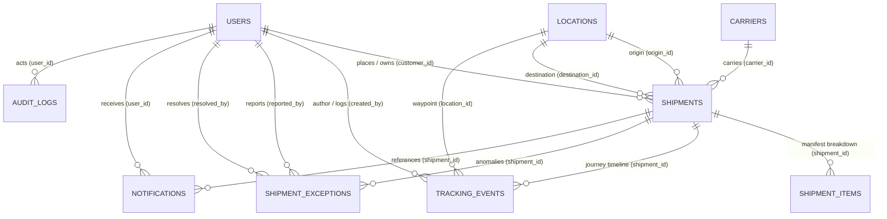

# CargoTrace: Entity Relationship Diagram (ERD) & Data Dictionary

This document details the complete relational data model designed for CargoTrace in accordance with **Web Programming 2 — UAS Final Project Specification (Slide 11)**.

---

## 1. Relational ERD Model

---

## 2. Cardinality & Design Decisions

1. **`users` (1) to `shipments` (N)**:
   - A client customer can book multiple freight shipments over time.
   - Each shipment has exactly one owning customer (`customer_id`).
   - Server-side authorization ensures customers can strictly view only shipments where `customer_id == Auth::id()`.

2. **`carriers` (1) to `shipments` (N)**:
   - Carriers (Maersk, Evergreen Marine, ONE, MSC, DHL) operate multiple consignments across global corridors.
   - Deletion of active carriers is constrained (`restrictOnDelete`) to safeguard historical manifest records.

3. **`locations` (1) to `shipments` (N) [Dual Foreign Keys]**:
   - `origin_id`: Origin port, airport, or intermodal terminal.
   - `destination_id`: Discharge destination port.
   - Validation strictly enforces `origin_id != destination_id`.

4. **`shipments` (1) to `tracking_events` (N)**:
   - Historical voyage progression is strictly append-only.
   - Past checkpoints are never overwritten or mutated when a new status is reached, preserving full chronological auditability.

5. **`shipments` (1) to `shipment_exceptions` (N)**:
   - Tracks operational anomalies (`CUSTOMS_HOLD`, `WEATHER_DELAY`, `PORT_CONGESTION`).
   - Each exception records reporter, resolver, detection timestamp, and resolution notes.

---

## 3. Data Dictionary Specification

### Table: `users`
| Column | Type | Nullable | Default | Description |
|---|---|:---:|---|---|
| `id` | BIGINT UNSIGNED (PK) | No | Auto | Primary identifier |
| `name` | VARCHAR(255) | No | - | User / Client representative name |
| `email` | VARCHAR(255) | No | - | Unique login email address |
| `password` | VARCHAR(255) | No | - | Bcrypt hashed password |
| `role` | VARCHAR(20) | No | `customer` | Role: `admin`, `operator`, `customer` |
| `company` | VARCHAR(255) | Yes | NULL | Business enterprise entity |
| `phone` | VARCHAR(30) | Yes | NULL | Telephone contact |
| `created_at`, `updated_at` | TIMESTAMP | Yes | NULL | Standard Laravel timestamps |

### Table: `carriers`
| Column | Type | Nullable | Default | Description |
|---|---|:---:|---|---|
| `id` | BIGINT UNSIGNED (PK) | No | Auto | Primary identifier |
| `name` | VARCHAR(255) | No | - | Operating carrier name (e.g. Maersk Line) |
| `code` | VARCHAR(20) | No | - | Standard SCAC carrier code (e.g. MAEU) |
| `contact_email` | VARCHAR(255) | Yes | NULL | Customer support email |
| `contact_phone` | VARCHAR(30) | Yes | NULL | Operations hotline |
| `website` | VARCHAR(255) | Yes | NULL | Tracking portal web link |
| `is_active` | BOOLEAN | No | TRUE | Operating status |

### Table: `locations`
| Column | Type | Nullable | Default | Description |
|---|---|:---:|---|---|
| `id` | BIGINT UNSIGNED (PK) | No | Auto | Primary identifier |
| `name` | VARCHAR(255) | No | - | Port or terminal name |
| `code` | VARCHAR(20) | No | - | UN/LOCODE (e.g. IDJKT, SGSIN, NLRTM) |
| `type` | VARCHAR(30) | No | `PORT` | `PORT`, `AIRPORT`, `WAREHOUSE`, `CHECKPOINT` |
| `city` | VARCHAR(100) | No | - | City name |
| `country` | VARCHAR(100) | No | - | Sovereign country |
| `latitude` | DECIMAL(10,7) | No | - | WGS84 coordinate latitude |
| `longitude`| DECIMAL(10,7) | No | - | WGS84 coordinate longitude |
| `timezone` | VARCHAR(50) | No | `UTC` | Local operational timezone |

### Table: `shipments`
| Column | Type | Nullable | Default | Description |
|---|---|:---:|---|---|
| `id` | BIGINT UNSIGNED (PK) | No | Auto | Primary identifier |
| `shipment_number` | VARCHAR(50) | No | - | Unique tracking number (`CT-YYYY-XXXX`) |
| `customer_id` | BIGINT UNSIGNED (FK) | No | - | References `users.id` |
| `carrier_id` | BIGINT UNSIGNED (FK) | No | - | References `carriers.id` |
| `origin_id` | BIGINT UNSIGNED (FK) | No | - | References `locations.id` |
| `destination_id` | BIGINT UNSIGNED (FK) | No | - | References `locations.id` |
| `cargo_type` | VARCHAR(50) | No | `GENERAL` | Cargo classification |
| `weight` | DECIMAL(10,2) | No | - | Consignment mass in kilograms |
| `volume` | DECIMAL(10,2) | Yes | NULL | Volumetric metric in CBM |
| `current_status` | VARCHAR(30) | No | `CREATED` | `CREATED`, `BOOKED`, `PICKED_UP`, `IN_TRANSIT`, `DELIVERED`, `CANCELLED` |
| `expected_departure` | DATETIME | No | - | Scheduled departure (ETD) |
| `actual_departure` | DATETIME | Yes | NULL | Actual vessel departure |
| `expected_arrival` | DATETIME | No | - | Scheduled arrival (ETA) |
| `estimated_arrival` | DATETIME | Yes | NULL | Dynamically adjusted ETA |
| `actual_arrival` | DATETIME | Yes | NULL | Actual cargo delivery |
| `is_delayed` | BOOLEAN | No | FALSE | Calculated delay flag |
| `delay_duration_minutes` | INT | No | 0 | Minutes behind schedule |
| `delay_severity` | VARCHAR(20) | No | `NONE` | `NONE`, `LOW`, `MEDIUM`, `HIGH` |
| `delay_reason` | TEXT | Yes | NULL | Explanation of delay calculation |
| `notes` | TEXT | Yes | NULL | Handling notes |
| `deleted_at` | TIMESTAMP | Yes | NULL | Soft delete support |

### Table: `tracking_events`
| Column | Type | Nullable | Default | Description |
|---|---|:---:|---|---|
| `id` | BIGINT UNSIGNED (PK) | No | Auto | Primary identifier |
| `shipment_id` | BIGINT UNSIGNED (FK) | No | - | References `shipments.id` |
| `location_id` | BIGINT UNSIGNED (FK) | Yes | NULL | References `locations.id` |
| `location_name` | VARCHAR(255) | No | - | Descriptive milestone title |
| `status` | VARCHAR(40) | No | - | Milestone stage |
| `event_time` | DATETIME | No | - | Historical event timestamp |
| `latitude` | DECIMAL(10,7) | Yes | NULL | Coordinate latitude |
| `longitude` | DECIMAL(10,7) | Yes | NULL | Coordinate longitude |
| `description` | TEXT | No | - | Progress commentary |
| `created_by` | BIGINT UNSIGNED (FK) | No | - | References `users.id` |
| `is_exception` | BOOLEAN | No | FALSE | Distinguishes anomaly from routine progress |
| `weather_snapshot` | JSON | Yes | NULL | Telemetry from Open-Meteo API |

### Table: `shipment_exceptions`
| Column | Type | Nullable | Default | Description |
|---|---|:---:|---|---|
| `id` | BIGINT UNSIGNED (PK) | No | Auto | Primary identifier |
| `shipment_id` | BIGINT UNSIGNED (FK) | No | - | References `shipments.id` |
| `exception_type` | VARCHAR(50) | No | - | `CUSTOMS_HOLD`, `WEATHER_DELAY`, `PORT_CONGESTION`, etc. |
| `severity` | VARCHAR(20) | No | `MEDIUM` | `LOW`, `MEDIUM`, `HIGH`, `CRITICAL` |
| `status` | VARCHAR(20) | No | `OPEN` | `OPEN`, `INVESTIGATING`, `RESOLVED` |
| `detected_at` | DATETIME | No | - | Occurrence timestamp |
| `resolved_at` | DATETIME | Yes | NULL | Resolution timestamp |
| `description` | TEXT | No | - | Incident report details |
| `resolution_notes` | TEXT | Yes | NULL | Resolution action notes |
| `reported_by` | BIGINT UNSIGNED (FK) | No | - | References `users.id` |
| `resolved_by` | BIGINT UNSIGNED (FK) | Yes | NULL | References `users.id` |

### Table: `notifications`
| Column | Type | Nullable | Default | Description |
|---|---|:---:|---|---|
| `id` | BIGINT UNSIGNED (PK) | No | Auto | Primary identifier |
| `user_id` | BIGINT UNSIGNED (FK) | No | - | Recipient (`users.id`) |
| `shipment_id` | BIGINT UNSIGNED (FK) | Yes | NULL | Related shipment reference |
| `type` | VARCHAR(50) | No | `INFO` | Alert classification |
| `title` | VARCHAR(255) | No | - | Notification headline |
| `message` | TEXT | No | - | Notification content |
| `read_at` | TIMESTAMP | Yes | NULL | Read acknowledgment timestamp |

### Table: `audit_logs`
| Column | Type | Nullable | Default | Description |
|---|---|:---:|---|---|
| `id` | BIGINT UNSIGNED (PK) | No | Auto | Primary identifier |
| `user_id` | BIGINT UNSIGNED (FK) | Yes | NULL | Actor (`users.id`) |
| `action` | VARCHAR(50) | No | - | Action tag (`CREATE`, `STATUS_CHANGE`, `LOGIN`, etc.) |
| `auditable_type` | VARCHAR(100) | No | - | Fully qualified model class name |
| `auditable_id` | BIGINT UNSIGNED | Yes | NULL | Target model ID |
| `old_values` | JSON | Yes | NULL | Snapshot before mutation |
| `new_values` | JSON | Yes | NULL | Snapshot after mutation |
| `ip_address` | VARCHAR(45) | Yes | NULL | Client IP address |
| `user_agent` | TEXT | Yes | NULL | Client browser or API client agent |
| `created_at` | TIMESTAMP | No | CURRENT | Immutable audit timestamp |
